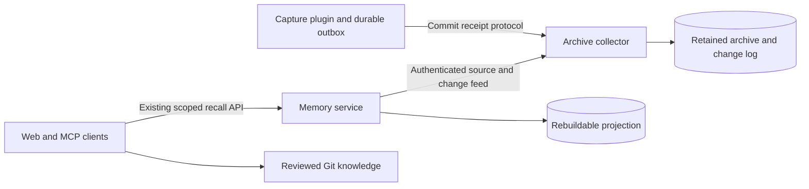

# Independent collection and memory services

The collector and memory backend run independently. A memory database, recall
credential, listener or indexing failure does not stop committed collection.
The collector no longer imports the memory engine or owns its lifecycle.



The authorities stay the same: the archive retains evidence, the memory database
is a derived index, and existing reviewed Git repositories own curated knowledge.
There is no second event bus or knowledge authority. The existing transactional
archive change log is the durable replay source; a volatile notification or an
HTTP search result is never a committed collection receipt.

## Responsibilities and contracts

| Component | Owns | Depends on |
| --- | --- | --- |
| Collector | Ingestion admission, raw archive transactions, commit receipts, archive APIs and authenticated feed | `storage.Backend` and its optional `MemoryFeed` |
| `cpa-memory-server` | Projection connection, index worker, recall HTTP, read credentials, source binding and owner lock | `storage.MemoryFeed` through `archivefeed.Client` |
| `cpa-memory` | Scoped read-only MCP and optional existing Git knowledge adapters | Recall `memory.Reader` HTTP client |
| `recallruntime` | Loopback HTTP, request cancellation, worker and reader shutdown | `memory.Projection` |
| `ingeststatus` | Shared collection telemetry DTOs | Archive capture DTOs; no recall engine |

`MemoryFeed` exposes source, changes, backfill and watermark capabilities without
SQL connections or filesystem paths. Its neutral `ErrSourceNotFound` means an
explicit authoritative absence, never a network or storage failure. Optional
`IdentityFeed` binds a projection to one archive; optional `RevisionFeed` avoids
transporting whole retained payloads for each search hit. The collector's SQLite
adapter remains explicit. A different backend must satisfy the same committed
source/revision/change semantics before it can serve this protocol.

The memory executable opens only its projection. It never opens the raw archive
or accepts the collector's SQL handle. The runtime accepts a `Projection` so a
future evaluated memory implementation can replace SQLite without changing the
collector, ingestion protocol, recall scopes or source-citation contract.

## Configure two processes

Create separate private read and archive-feed credentials with at least 32
printable ASCII characters. Keep credential files mode 0600 and their directory
private. The feed token grants access to complete retained source records and
must never be given to ordinary recall/MCP clients or reused as a read token.

Collector settings:

```sh
ARCHIVE_DB=/absolute/path/to/existing/archive.sqlite \
LISTEN_ADDR=127.0.0.1:8318 \
ARCHIVE_FEED_TOKEN_FILE=/private/credentials/archive-feed.token \
cpa-session-collector
```

Memory service settings, in a separate process:

```sh
MEMORY_DB=/absolute/path/to/memory.sqlite \
MEMORY_ARCHIVE_ENDPOINT=http://127.0.0.1:8318 \
MEMORY_ARCHIVE_TOKEN_FILE=/private/credentials/archive-feed.token \
MEMORY_LISTEN_ADDR=127.0.0.1:8319 \
MEMORY_READ_TOKEN_FILE=/private/credentials/memory-read.token \
cpa-memory-server
```

`MEMORY_READ_CREDENTIALS_FILE` still supplies optional scoped read credentials.
The Web page, HTTP paths, MCP tools and citation formats remain compatible.
The memory database must be a private regular file, or a new absolute path.
A mistaken archive database is rejected before modifying its schema or metadata.
A canonical-path owner lock prevents two new memory daemons from writing the
same projection. Stop the legacy embedded collector before the first migration;
older binaries do not participate in this owner lock.

`MEMORY_ENABLED=true` no longer starts recall inside the collector. It emits a
migration notice and collection continues independently. Remove legacy memory
settings from the collector's service configuration. An absent feed token leaves
the optional API disabled; an invalid configured token/listener disables that
feed with HTTP 503 and a sanitized log while ingestion remains available.

Both listeners stay on loopback. The feed client accepts only a literal loopback
HTTP origin, bypasses environment proxies and refuses redirects. Existing SSH
forwarding of 18319 to 8319 remains unchanged for the recall UI/MCP client.

## Feed protocol v1

The dedicated token protects GET requests under `/internal/archive-feed/v1/`:

| Endpoint | Response |
| --- | --- |
| `manifest` | Version, persistent archive ID, watermark and explicit history completeness |
| `changes?after=N&limit=L` | Strictly increasing invalidation sequence and request IDs, at most 256 |
| `backfill?after_id=N&limit=L` | Retained source IDs, row cursor and completion, at most 256 |
| `source?id=ID` | Atomic current record, opaque source revision and source sequence |
| `revision?id=ID` | Current revision without transmitting retained payloads |
| `ingestion` | Current collector/producer telemetry, independently bounded from recall |

Authenticated replies carry protocol/version and archive-ID headers. The client
checks identity on every response, including missing sources. Only an explicit
`source_missing` response from the source/revision route maps to source absence.
Authentication, startup, transport, cancellation, oversized/malformed responses,
unknown routes and backend errors remain failures. They cannot delete indexed
rows, masquerade as empty pages or advance the projection checkpoint.

The feed remains unavailable until the collector's repair/readiness chain is
complete. The known SQLite backend explicitly declares complete retained event
history; other providers default to incomplete. Events are invalidations followed
by a current atomic source read, not historical record snapshots. Source sequence
may exceed the event being replayed. Row-ID backfill and later complete change
replay together handle concurrent replacement, deletion and row-ID reuse.

Client metadata responses are limited to 1 MiB, full sources to 256 MiB, and
requests have a 30-second ceiling plus the caller's shorter deadline. Server
source reads have two slots and revision reads four, separate from ingestion
admission. Oversized sources fail explicitly; there is no truncation with an old
revision and no cursor advance. Revision checks still recompute authoritative
current revisions; there is no cross-request permission or visibility cache.

## Binding, outages and recovery

The raw database stores a stable random archive identity, preserved in online
backups. The projection stores that identity and a monotonic observed watermark
as additive metadata without changing projection v3 or normalizer v2. Only its
worker establishes/updates the binding; query readers never do so. Different
archive identity, incomplete history, or a source watermark below the committed
checkpoint/observed watermark requires operator repair or rebuild. It cannot be
hidden by reporting zero lag. Source sequences observed during projection also
raise this fence in the projection transaction.

A completely fresh projection may bind automatically. A legacy projection with
sources or existing cursor/backfill progress requires the explicit, one-time
`MEMORY_ADOPT_ARCHIVE_SOURCE=true` migration setting after verifying the intended
archive and rollback set. This preserves its checkpoint and existing citations.
Remove that setting after successful binding. It never bypasses an established
binding, lost history or watermark rollback. Do not point an existing index at
another archive and reuse its old cursor.

If memory is stopped, collection and archive receipts continue. Restart memory to
replay from its committed checkpoint. If the collector/feed is unavailable,
memory stays alive and `/healthz` remains available; `/readyz` and data operations
fail until source checks can succeed. It does not serve unvalidated cached
excerpts. The worker retries errors with a 1–30 second capped backoff and resets
on success. Its state/checkpoint transactions remain idempotent across restarts.
Optional collection diagnostics have a separate one-second request budget; a
failed observation is omitted, never cached or allowed to suppress valid evidence.

SIGTERM/SIGINT cancels source work, stops HTTP admission, drains active readers
and waits for the projection worker before closing the index and releasing the
owner lock. Unexpected worker/listener exit terminates the memory service so its
service manager can restart it. Memory readiness is separate from index freshness;
inspect returned lag before treating it as caught up.

## Verification and migration

Test collection with memory absent or misconfigured; verify exact archive commit
receipts. Test memory startup while the feed is offline, resume and replay,
source deletion/move, protocol/auth failures, source identity/history rollback,
first legacy binding, duplicate writers and graceful shutdown. Keep frozen
retrieval quality and current citation/scoping tests unchanged. A process split
must be measured for full-source transport and live query latency, not assumed
faster because its interfaces are narrower.

Before replacement, preserve verified online raw/projection/outbox backups,
collector/MCP artifacts, launchd configuration, credentials and install manifest.
Stop the old embedded worker, start the new collector feed, then start the memory
LaunchAgent at the existing recall port using the existing projection/read tokens.
After binding/catch-up, remove migration authorization and verify another memory
restart. Rollback stops the independent memory process first, then restores the
old collector and its embedded-memory environment; preserve active data and the
producer outbox. Never restore only an old raw database under a newer bound
projection. Follow the [M4 runbook](mac-mini-deployment.md) and retain the newest
verified complete rollback set.
