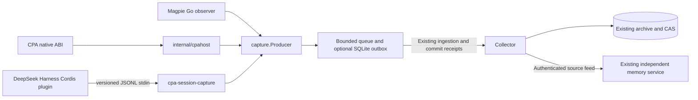

# Shared capture and host plugins

This is a development implementation. It does not install plugins, change client
configuration, restart live services, or activate new memory features.

## Boundaries



| Package | Responsibility | Explicit boundary |
| --- | --- | --- |
| `record` | Retained record DTO and weight accounting | No database, host ABI or frontend dependency |
| `delivery` | Capture status DTO and compatible receipt constants | No SQLite driver or service initialization |
| `internal/sessionmodel` | Shared protocol metadata, previews and session normalization | No SQL, transport or plugin lifecycle |
| `capture` | Typed lifecycle events, completed-record submission, admission, retry, outbox and shutdown | Does not import the archive store or CPA host |
| `internal/cpahost` | CPA JSON/YAML envelopes, registration, management routes and resource serving | Uses capture; does not own archive SQL |
| `internal/archive/web` | Embedded single-file workspace | Keeps the existing generated HTML path; independent Go package |
| `internal/archive`, `internal/storage` | Persistence, CAS, queries, exports and management state | Existing database and API contracts retained |

The existing `archive.Record` and telemetry names remain aliases so collector,
import, memory and export code share the same wire schema. Existing archive
normalization helpers delegate to the extracted implementation. There is no
second archive schema or new memory authority.

`capture.Producer` accepts either typed lifecycle calls (`CaptureRequest`,
`CaptureResponse`, `CaptureChunk`, `Complete`) or a completed `record.Record`
through `Submit`. CPA owns its wire-format interpretation. New hosts do not
fabricate CPA callback JSON. `Submit` clones retained payloads/facets, enforces
body bounds, derives searchable previews and accepts an explicit session scope.
A rejected queue admission returns an error and remains retryable. Duplicate
accepted request IDs are suppressed within the bounded process-local window.

## CPA compatibility

The C ABI entrypoints, schema version 5, plugin ID, configuration keys,
management routes, generated workspace HTML location and ingestion protocol stay
compatible. The native entrypoint now instantiates `cpahost.NewPlugin`.

Original capture, late-chunk, duplicate-completion, queue pressure, retry,
shutdown and outbox recovery tests moved with their implementations. Management
resource/proxy tests moved to the host adapter. A wire-level regression sends
actual CPA-style callback JSON through registration, streaming capture and
completion to a synthetic collector.

## Magpie

Reference host: [yetone/magpie](https://github.com/yetone/magpie), relevant source
at commit `1bd99194eab5d5cd76042e9a27d0ce25c2beecba`.

`integrations/magpie` is a Go plugin registered with `pluginrt.Manifest` and
implemented against the actual `usage.Observer`/`usage.Watch` interfaces. It asks
for `WholeBodies`, records each routing attempt with an independent request ID,
retains a shared trace ID, and records early rejections when no attempt exists.
Native sessions are explicitly namespaced as `magpie:<session>`; requests with
no trustworthy session use a per-request fallback. It never retains the
observer request's bearer headers.

The host scrubs exported observer bodies before handing them to the plugin.
Records expose `capture.host=magpie` and `capture.layer=scrubbed-observer` and
preserve the host truncation marker as partial evidence. These are not claims
about original unsanitized transport bytes. Provider metadata not supplied by
the observer is not guessed.

Magpie's community JS middleware cannot implement this complete contract: it
runs without Node/network APIs, and its usage hook has no bodies or request IDs.
The current adapter therefore requires a custom Magpie build. For a later
operator-approved integration, add `plugin.go` to an in-tree
`plugins/sessionarchive` package, import it from `plugins/all`, and resolve this
archive checkout as a local Go module. The archive's current module identity is
`cpa-session-archive`, so remote `go get` publication is not claimed.

The standalone adapter module and verification workspace support compiling
against a separate host checkout without editing it. Full host-build verification
uses a temporary Go overlay to add the registration import; source files and
installed Magpie artifacts remain untouched.

Plugin settings are `endpoint` (default `http://127.0.0.1:8318`) and `spoolDir`.
Use a separate private absolute spool directory to enable durable replay.
Without one, delivery uses the existing volatile queue boundary. The observer
starts only while the gateway serves it. Stop waits up to five seconds for
volatile admission to drain, then preserves pending outbox entries.

## DeepSeek Harness

Reference host: [deepseek-ai/deepseek-harness](https://github.com/deepseek-ai/deepseek-harness),
relevant source at commit `687f282e8625c6b8d11ff58211a90524be2e4317`.

`integrations/deepseek-harness` is a Cordis plugin package and a disabled-by-default
DSH bundle. Its `llm/stream` listener delegates to `next()` exactly once, yields
original chunks unchanged, propagates downstream exceptions, and preserves
consumer cancellation. It snapshots only the provider-neutral request contract;
`AbortSignal` and service objects are excluded. It does not observe raw provider
HTTP traffic or load attachment bytes from referenced local files.

The retained request includes compatible messages/tool schemas alongside the
original provider-neutral envelope. The response includes compatible assistant
messages/tool calls alongside retained stream chunks. Namespaced session/request
IDs distinguish this capture source from CPA and Magpie. Tool results are captured
when supplied in a subsequent model request; this hook does not independently
observe tool execution or guarantee capture of tool results never sent to a model.

`capture.host=deepseek-harness` and `capture.layer=provider-neutral` make the
capture boundary explicit. A bounded snapshot that cannot fit is reported as
truncated; original chunks still reach the caller. A stream ending without its
finish chunk is incomplete, not a successful model completion. Only observed failure metadata supplies an HTTP status; successful model output
does not invent a transport status. Each callback invocation is a separate request; no turn identity is invented from messages.

The plugin starts the operator-selected absolute `cpa-session-capture` binary.
Its completed-record input is one JSON object per line:

```json
{"version":1,"record":{"request_id":"host:request","session_id":"host:session","original_request":"BASE64","response":"BASE64"}}
```

The record fields are the existing archive wire schema; byte fields are Base64.
Stdout reports readiness and admission/capture counters, never the private record.
Admission is not a durable receipt. Go owns persistence/replay/receipt verification.
The plugin bounds pending pipe writes, drains child status/diagnostics, refuses
redirected/non-loopback destinations through the shared delivery boundary, and
never spawns a shell. Capture failures do not replace model results. A dead child
requires plugin reload; automatic process supervision is not implemented.

`ctx.effect` owns companion cleanup. Unloading closes stdin, waits for the child,
and bounds the shutdown with a six-second termination fallback. The companion
allows five seconds to persist queued work. Preserve its outbox across reloads;
pre-persistence crashes, exhausted capacity and forced shutdown remain loss windows.
Pending pipe overflow increments the transport's process-local `dropped` counter.

After a future authorized installation, configure the plugin row with:

```yaml
name: '@aias/dsh-session-archive'
config:
  binary: /absolute/path/to/cpa-session-capture
  endpoint: http://127.0.0.1:8318
  spoolDir: /absolute/private/deepseek-harness-outbox
  maxBodyBytes: 67108864
  maxPendingBytes: 268435456
```

The shipped bundle row is disabled until configured. The companion is a native
executable built separately from the npm package; no installer is run by the
plugin. Existing recall Web/MCP and reviewed Git knowledge remain separate
services. This implementation does not inject memory into model requests or
port CPA's authenticated management panel into either new host's UI.

## Build and verify

Use the repository's pinned Node/pnpm environment and a native Go SDK:

```sh
pnpm typecheck
pnpm test:scripts
pnpm build:plugins
go test -race ./...
go vet ./...
CGO_ENABLED=0 go test ./record ./delivery
go build -o /your/development/output/cpa-session-capture ./cmd/cpa-session-capture
```

`pnpm build:plugins` emits the DSH JavaScript and declarations under
`integrations/deepseek-harness/lib`. It installs/publishes nothing. Existing
release image and publication contracts are not expanded by this development
increment.

Run actual host-source acceptance with explicit source paths:

```sh
MAGPIE_SOURCE=/path/to/magpie \
DSH_SOURCE=/path/to/deepseek-harness \
GO_BINARY=/absolute/path/to/go \
pnpm verify:host-plugins
```

The verifier creates a private temporary workspace. It runs Magpie observer race
tests, builds the actual Magpie host with the registration overlay, and builds
an isolated collector and companion. It bundles the actual Cordis/cosmokit
sources to verify waterfall registration, unchanged stream objects, direct loading of the exported plugin with service
injection, committed SQLite evidence and disposal. It removes only its own temporary fixtures.
Go may download the host's newer toolchain; it does not replace the configured SDK.

Root CI tests the shared packages/CPA adapter, checks TypeScript plugin behavior,
builds the DSH package and companion, and confirms schema/status packages compile
without CGO. Host-source acceptance is an explicit additional check requiring
the two source checkouts, not a claim made by the root suite alone.

## Development acceptance, 2026-10-21

Verification used archive Go 1.26.3, Magpie's Go 1.26.8 requirement, and Node
24.22.1. The complete repository race suite and `go vet` passed. All 28
script/parser/repository/plugin cases, root/frontend TypeScript checks, the DSH
package build and deterministic workspace build comparison passed.

Actual-host verification passed Magpie observer race tests and the complete
`nogui` native host build with its temporary registration overlay. Actual Cordis
source successfully loaded the exported plugin with `llm` injection, streamed
unchanged objects, committed synthetic evidence through the Go companion and
collector to SQLite, and removed listeners/closed the companion on disposal.

Native CPA C-shared plugin, collector and capture companion builds passed. The
plugin retains all four ABI declarations and contains the exact 525,663-byte
workspace. The local DSH tarball contains JavaScript, declarations, the disabled
bundle patch, README and license. Artifact hashes and aggregate checks are in a
local development verification manifest. No production database, installed
binary, client configuration or live service was changed.
